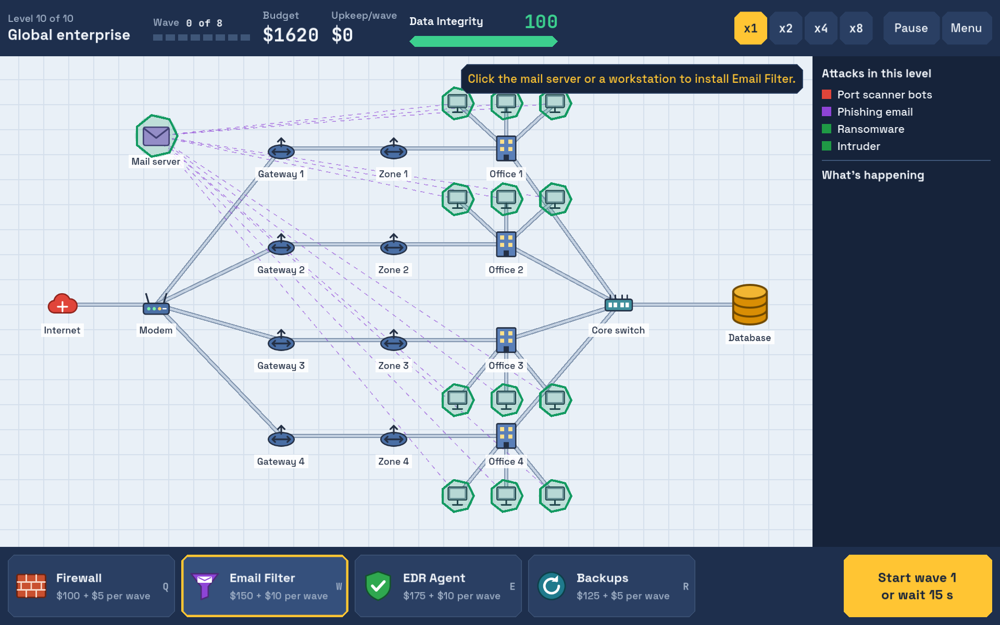
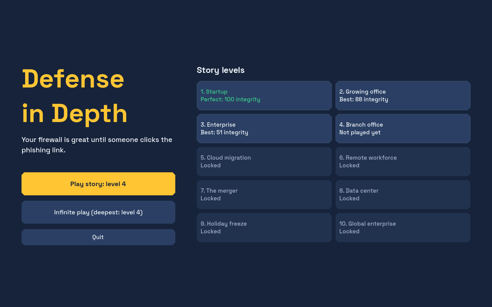

# Defense in Depth

A 2D tower defense game about real security thinking. You run security for a growing company and defend its network on a limited budget. Your firewall is great until someone clicks the phishing link.

Built with Godot 4.7 and GDScript.



## Features

- **Different attacks take different paths.** Network traffic follows cables, phishing reaches employees directly, and compromised workstations attack from inside your perimeter.
- **Layered defense wins.** Firewall, Email Filter, EDR and Backups each do one job, and extra copies of the same defense cost more upkeep.
- **10 story levels,** from a startup to a global enterprise, with your best result saved for each. Can you finish them all at 100 Data Integrity?
- **Infinite play,** with random networks that keep getting harder until one beats you.
- **Incident reports** that explain what got in, the path it took and what would have stopped it.
- **Game speed** from x1 to x8, without changing the outcome.



## Play

**On Windows, from a release:** download and unzip a release, then double-click `runner.bat`. You don't need to install Godot.

**From source:**

1. Install the standard (non-.NET) [Godot 4.7.2](https://godotengine.org/download/archive/).
2. Open `project.godot` in the Godot editor.
3. Press F5.

The [user manual](docs/user-manual.md) covers controls, attacks, defenses and tips.

## Development

Run the tests from the repo root:

```powershell
godot --headless --path . --import
godot --headless --path . -s addons/gut/gut_cmdln.gd -gdir=res://tests -gexit
```

Here, `godot` means your Godot console executable. On Windows, that's `Godot_v4.7.2-stable_win64_console.exe`.

The [system manual](docs/system-manual.md) covers architecture, building, adding content and troubleshooting.

## Documentation

| Document | Contents |
| --- | --- |
| [User manual](docs/user-manual.md) | How to play |
| [System manual](docs/system-manual.md) | How to build, test and extend the game |
| [Game design document](Defense%20in%20Depth%20—%20Game%20Design%20Document.md) | Design goals, mechanics and future plans |
| [Technical design](docs/technical-design.md) | Code structure and interfaces |
| [Balance sheet](docs/balance-sheet.md) | Game values and tuning results |
| [Decision log](docs/decisions.md) | What was decided and why |
| [Implementation plan](docs/implementation-plan.md) | The original prototype plan |

## Project status

This is a playable prototype that hasn't been through wider playtesting yet, so its balance may change. Levels 4-10 reuse the same three attacks on larger networks, and more attack types are planned in the design document. The web export builds, but it hasn't been tested in a browser yet.

## License

The game's code, documents and icons are available under the [MIT License](LICENSE).

Third-party components keep their own licenses:

| Component | License | Location |
| --- | --- | --- |
| [Godot Engine](https://godotengine.org/), included in exported builds | MIT | [License](https://godotengine.org/license/) |
| [GUT](https://github.com/bitwes/Gut) 9.7.1, for tests only | MIT | `addons/gut/LICENSE.md` |
| [Space Grotesk](https://github.com/floriankarsten/space-grotesk) font | SIL OFL 1.1 | `art/fonts/SpaceGrotesk-OFL.txt` |
| [JetBrains Mono](https://github.com/JetBrains/JetBrainsMono) font | SIL OFL 1.1 | `art/fonts/JetBrainsMono-OFL.txt` |

The company and attackers in this game are fictional, and the game contains no technical attack instructions.
